# Jet Force Gemini: Recompiled · Official Mods

The official mods for [Jet Force Gemini: Recompiled](https://github.com/VibinToast/JetForceGemini-Recomp), with new weapons, a new enemy, HUD redesigns and gameplay options. Every mod lives in its own folder with its own README, and is versioned and released on its own.

## Installing

The easy way is the game's launcher: **Get Mods** lists every mod here, installs it with what it needs, and shows when one has an update. By hand: download a mod's `.nrm` from [Releases](https://github.com/VibinToast/JFG-Mods/releases) and put it in the game's `mods` folder. Turn mods on and off, and change their options, on the **Mods** page.

## The mods

| | Mod | | Tags | Version |
|---|---|---|---|---|
| 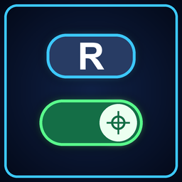 | **[Toggle Aim](jfg_aim_toggle/README.md)** | Press the aim button once to aim, again to stop. | Controls | 1.1.0 |
|  | **[Ammo Ring](jfg_ammo_ring/README.md)** | A sharp, modern weapon panel: an ammo ring, a weapon fan, a Tribal badge and a pick-up feed. | HUD | 1.0.0 |
| 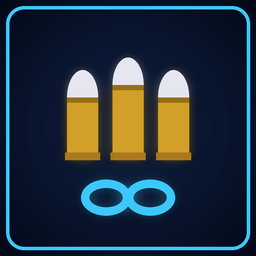 | **[Ammo Stays](jfg_ammo_stays/README.md)** | Ammo dropped by enemies no longer disappears. | Gameplay | 1.1.0 |
| 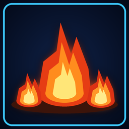 | **[Better Flamethrower](jfg_better_flamethrower/README.md)** | Ground fires, spreading burns and stronger flames. | Weapons | 1.1.0 |
|  | **[Better Floyd](jfg_better_floyd/README.md)** | Floyd shoots enemies, warns you of Tribals and talks; Hide Floyd. | Gameplay | 1.2.0 |
|  | **[Better Shocker](jfg_better_shocker/README.md)** | The shock arcs from enemy to enemy and stuns them. | Weapons | 1.1.0 |
| 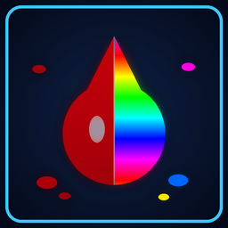 | **[Blood](jfg_blood/README.md)** | Blood options: none, more, splats that stay, colours per creature, rainbow blood. | Visuals | 1.1.0 |
|  | **[Concussion Cannon](jfg_concussion_cannon/README.md)** | A charged cone of force that knocks enemies back and slams them into walls. | Weapons | 0.2.0 |
|  | **[Dodge](jfg_dodge/README.md)** | Click the right stick to dodge where you move, briefly safe from harm. | Gameplay | 1.1.0 |
| 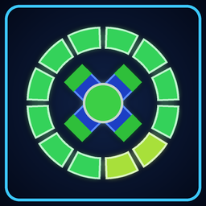 | **[Health Ring](jfg_health_ring/README.md)** | A sharp, modern health meter that grows into a full ring with every health upgrade. | HUD | 1.0.0 |
| 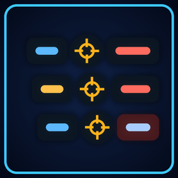 | **[Kill Feed](jfg_kill_feed/README.md)** | Who killed what, with which weapon: a modern kill feed at the top right. | HUD | 1.0.0 |
| 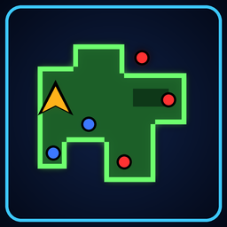 | **[Minimap](jfg_minimap/README.md)** | An always-on map of the area, with you, tribals and pickups. | HUD | 1.0.0 |
| 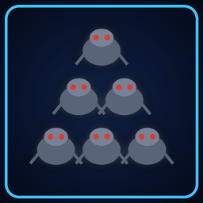 | **[More Enemies](jfg_more_enemies/README.md)** | Two or three times the enemies in every squad. | Enemies, Gameplay | 0.1.0 |
| 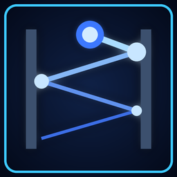 | **[Ricochet Plasma](jfg_plasma_ricochet/README.md)** | Charged plasma shots bounce off walls and split at every bounce. | Weapons | 1.0.0 |
| 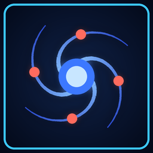 | **[Plasma Vortex](jfg_plasma_vortex/README.md)** | Charged plasma shots pull enemies in, then burst. | Weapons | 1.0.0 |
|  | **[Quick Talk](jfg_quick_talk/README.md)** | Hint characters turn to you and talk at once: no walking up, no slow turn. | Gameplay | 0.1.0 |
| 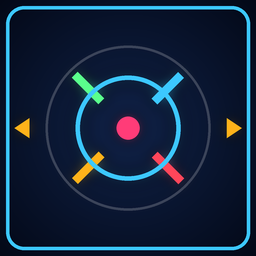 | **[Reticle](jfg_reticle/README.md)** | No snapping to enemies; reticle shape, colour and size. | HUD | 1.1.0 |
| 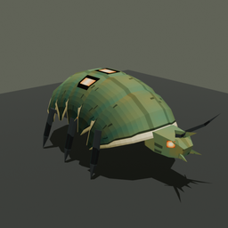 | **[Rolling Shellback](jfg_shellback/README.md)** | A new enemy: an armoured beetle that curls up, rolls at you and fires spines. | Enemies | 0.1.0 |
| 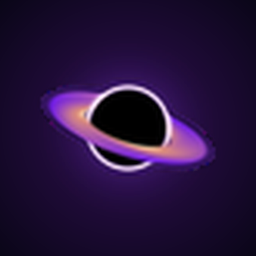 | **[Singularity](jfg_singularity/README.md)** | A thrown black hole that pulls enemies in, then collapses in a blast. | Weapons | 0.2.0 |
|  | **[Weapon Sounds](jfg_weapon_sounds/README.md)** | The weapons' sounds remastered: modern, punchy and heavy, each one switchable. | Weapons, Audio | 1.0.0 |
|  | **[Shellback Burrows](toast_shellback_levels/README.md)** | Rolling Shellback squads lurk in caves and around cave mouths across the game. | Enemies, Levels | 0.2.0 |

## Releases

Each mod is released on its own, tagged `<mod id>-v<version>` (for example `jfg_ammo_ring-v1.0.0`), with its `.nrm` and `thumb.png`. The latest release also carries `catalog.json`: the list of every mod's newest version, which the launcher's Get Mods page reads. Updating one mod releases only that mod.

## Building a mod

You need:

- `clang` and `ld.lld` (LLVM 15 or newer, with the MIPS target), and `make`. On Windows, use WSL.
- `RecompModTool` from [VibinToast/N64Recomp](https://github.com/VibinToast/N64Recomp), branch `jfg-wrapped-unhookable` (it writes the manifest's `tags`). Point `MODTOOL` at it if it isn't in `~/tools/modkit/N64Recomp/build/`.
- The game's symbol files from [VibinToast/JFGRecompSyms](https://github.com/VibinToast/JFGRecompSyms): point `SYMS` at a checkout of it.

Then, in a mod's folder:

```sh
make SYMS=/path/to/JFGRecompSyms
make nrm SYMS=/path/to/JFGRecompSyms
```

The `.nrm` is written to `build/<mod id>.nrm`. Mods with their own models or sounds also have the scripts that make them (`build_assets.py`, `make_sounds.py`); their outputs are committed, so a plain build doesn't need them.

Mods use only the port's mod API (`include/jfg_api.h`), not the game's own code. Its reference is on the [modding wiki](https://jfg.vibintoast.com).

## License

[MIT](LICENSE). Jet Force Gemini itself is not included: the mods need the game and the port.
