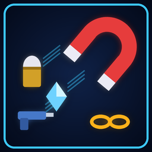

# Better Pickups



**Drops stay until you take them, a drop rate for mods' items, and a pickup magnet.**

Version **2.0.0** · Gameplay · by VibinToast · needs Jet Force Gemini: Recompiled 1.3.0 or newer

## About

Everything enemies drop, your way. The ammo, weapons and drone heads enemies leave behind no longer vanish after a few seconds: they wait for you (the newest ones, so the game never runs short of room for more). Set how often enemies drop the items other mods add, such as the new weapons' ammo cells: from none to three times as many. And turn on the pickup magnet to have drops near you drift into your hands, so you don't have to walk over every one of them in the middle of a fight.

## Options

Change them in the game's Mods menu (the mod's Configure page) or on the launcher's Mods page.

| Option | What it does | Choices | Default |
|---|---|---|---|
| **On** | The mod on or off: the mods menu's On/Off switch, which works during play too. | Off / On | On |
| **Ammo Stays** | Ammo dropped by enemies stays until you pick it up. | Off / On | On |
| **Weapons Stay** | Weapons dropped by enemies stay until you pick them up. | Off / On | On |
| **Drone Heads Stay** | Drone heads dropped by enemies stay until you pick them up. | Off / On | On |
| **Drops Kept** | How many of the newest drops are kept at once. Older ones fade as in the game, so the game always has room for new ones. | 8 to 128, steps of 8 | 48 |
| **Mod Drop Rate (%)** | How often enemies drop the items other mods add (the new weapons' ammo cells and the like). 100 is each mod's own rate, 0 none, 300 three times as often. | 0 to 300, steps of 25 | 100 |
| **Pickup Magnet** | Drops near you drift to you and are picked up: ammo, weapons, drone heads and mods' items. Short reaches a few steps, Long across a room. | Off / Short / Long | Off |

## Install

- **In the game's launcher:** open **Get Mods**, pick this mod and press **Install** (it keeps it up to date).
- **By hand:** download `jfg_better_pickups.nrm` from its release, [`jfg_better_pickups-v2.0.0`](https://github.com/VibinToast/JFG-Mods/releases/tag/jfg_better_pickups-v2.0.0), and put it in the game's `mods` folder.

## Build

From this folder, as in the [collection's README](../README.md#building-a-mod):

```sh
make SYMS=/path/to/JFGRecompSyms && make nrm SYMS=/path/to/JFGRecompSyms
```

The mod is written to `build/jfg_better_pickups.nrm`.

## What's here

- `src/`: the mod's C code
- `include/`: the port's mod API headers (`jfg_api.h`, `jfg_util.h`), copied from the port
- `mod.toml`: the manifest: name, version, tags, options
- `Makefile`: builds the mod (`make`, then `make nrm`)
- `mod.ld`: the linker script
- `thumb.png`: the picture shown in the Mods menu and on Get Mods
