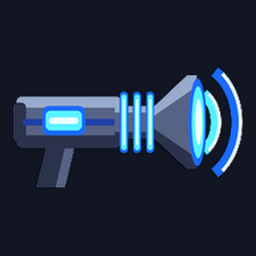

# Concussion Cannon



**A charged cone of force that knocks enemies back and slams them into walls.**

Version **0.2.0** · Weapons · by VibinToast · needs Jet Force Gemini: Recompiled 1.3.0 or newer

## About

A new weapon: hold fire to charge the Concussion Cannon, let go to fire a cone of force along your aim. Every enemy in the cone is knocked away, light ones far and heavy ones barely; flyers spin off through the air. An enemy knocked into a wall fast enough slams into it and takes damage, and the kill is the cannon's. The more you charge, the further and harder it hits, and the more it pushes you back. It sits with your other weapons (next / previous weapon), and what you carry is saved with your file. More charges come from enemy drops, plasma shotgun pickups (some of them turned into cannons) and an optional recharge. Set its range, cone, force, damage and recoil.

## Options

Change them in the game's Mods menu (the mod's Configure page) or on the launcher's Mods page.

| Option | What it does | Choices | Default |
|---|---|---|---|
| **On** | The mod on or off: the mods menu's On/Off switch, which works during play too. | Off / On | On |
| **Start With It** | Your hero has the Concussion Cannon from the start. | Off / On | On |
| **Infinite Ammo** | Shots use no charges: the cannon is always full (the ammo options below then don't matter). | Off / On | On |
| **Range** | How far a full charge reaches, in level units (a weak shot reaches 40% of it). | 100 to 800, steps of 25 | 800 |
| **Cone Width (degrees)** | How wide the cone of force is. | 20 to 120, steps of 5 | 50 |
| **Force** | How hard it knocks enemies away, in percent (100 is a solid shove; heavy enemies need more). | 20 to 600, steps of 10 | 510 |
| **Blast Damage** | Damage the blast itself does at full charge up close, in hundredths of a unit of health (0: none, it only knocks back). | 0 to 1000, steps of 25 | 0 |
| **Wall Slam Damage** | Damage an enemy takes when knocked into a wall, in hundredths of a unit of health (harder slams more). | 0 to 2000, steps of 50 | 1550 |
| **Recoil** | How far a shot pushes you back, in percent (0: not at all). | 0 to 200, steps of 10 | 100 |
| **Screen Shake** | How much a shot shakes the view, in percent (0: not at all). | 0 to 200, steps of 10 | 100 |
| **Push Tribals** | Tribals in the cone are knocked back too (never hurt by the blast or a wall slam). | Off / On | On |
| **Ammo: Enemy Drops** | Enemies you kill sometimes drop a charge cell (big ones twice as often): walk into it to take two charges. | Off / On | On |
| **Drop Chance (%)** | How likely a kill is to drop a cell. Shared with other mods' drops: a kill drops at most one, and from squads made bigger by More Enemies the chance is shared out over the extra enemies. | 1 to 50, steps of 1 | 8 |
| **Ammo: Plasma Shotgun Pickups** | Picking up the plasma shotgun or its ammo gives three charges too. | Off / On | On |
| **Ammo: Cannon Pickups (%)** | This share of the level's plasma shotgun pickups give the Concussion Cannon instead (they still look like the shotgun's). 0: none. | 0 to 100, steps of 5 | 25 |
| **Ammo: Recharge** | One charge comes back by itself every so often, while you have fewer than it holds. | Off / On | Off |
| **Recharge Time (s)** | Seconds for one charge to come back (with Recharge on). | 2 to 120, steps of 1 | 15 |
| **Debug Line** | For testing: a line at the top left with the charge and what the last shot hit. | Off / On | Off |

## Install

- **In the game's launcher:** open **Get Mods**, pick this mod and press **Install** (it keeps it up to date).
- **By hand:** download `jfg_concussion_cannon.nrm` from its release, [`jfg_concussion_cannon-v0.2.0`](https://github.com/VibinToast/JFG-Mods/releases/tag/jfg_concussion_cannon-v0.2.0), and put it in the game's `mods` folder.

## Build

From this folder, as in the [collection's README](../README.md#building-a-mod):

```sh
make SYMS=/path/to/JFGRecompSyms && make nrm SYMS=/path/to/JFGRecompSyms
```

The mod is written to `build/jfg_concussion_cannon.nrm`.

## What's here

- `src/`: the mod's C code
- `include/`: the port's mod API headers (`jfg_api.h`, `jfg_util.h`), copied from the port
- `assets/`: the built models, textures and animations the mod adds to the game (made by `build_assets.py`)
- `art/`: the scripts (Blender, Python) and source pictures the assets are made from
- `concepts/`: concept sheets and notes for the design
- `sounds/`: the mod's sound effects (made by `make_sounds.py`)
- `mod.toml`: the manifest: name, version, tags, options
- `Makefile`: builds the mod (`make`, then `make nrm`)
- `mod.ld`: the linker script
- `thumb.png`: the picture shown in the Mods menu and on Get Mods
- `jfg_sounds.json`: which sounds the mod plays or replaces
- `jfg_assets.json`: the assets the mod adds, for the port to load
- `build_assets.py`: makes `assets/` from `art/`
- `make_sounds.py`: synthesizes the sounds in `sounds/`
