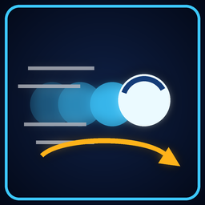

# Dodge



**Click the right stick to dodge where you move, briefly safe from harm.**

Version **1.1.0** · Gameplay · by VibinToast · needs Jet Force Gemini: Recompiled 1.3.0 or newer

## About

Better mobility: click the right stick (or press N64 L with the classic controls) to dash in the direction you are moving, strafing while aiming included; standing still, you hop back. For the first moment of the dodge nothing can hurt you (it can tint the hero red while it lasts), you can keep firing, and Juno and Vela roll. Choose how far it takes you, how long you are protected and how soon you can dodge again.

## Options

Change them in the game's Mods menu (the mod's Configure page) or on the launcher's Mods page.

| Option | What it does | Choices | Default |
|---|---|---|---|
| **On** | The mod on or off: the mods menu's On/Off switch, which works during play too. | Off / On | On |
| **Dodge Button** | On a modern controller: the right stick's click, or N64 L (the left bumper, as you bound it; Back opens the settings and never dodges). The classic controls always use N64 L. | Right Stick Click / N64 L | Right Stick Click |
| **Distance** | How far a dodge takes you, in level units (a hero is about 50 tall). | 50 to 400, steps of 10 | 200 |
| **Dodge Time (1/100 s)** | How long a dodge takes to cover its distance: the roll ends with it. Less is a snappier dodge. | 15 to 200, steps of 5 | 55 |
| **Protection (1/100 s)** | How long nothing can hurt you from the start of a dodge. 0 = no protection. | 0 to 100, steps of 5 | 60 |
| **Red Tint While Protected** | The hero is tinted red while nothing can hurt it, so you can tell how long that lasts. | Off / On | Off |
| **Cooldown (1/100 s)** | How long after a dodge until the next one. | 20 to 300, steps of 10 | 120 |
| **Roll** | Juno and Vela roll as they dodge (the game's own side roll), to the side the dodge goes. | Off / On | On |
| **Jump Sound** | The hero's own jump voice (Juno's, Vela's or Lupus's) plays with each dodge. | Off / On | On |
| **Shoot While Dodging** | Keep firing through a dodge. Off: the fire button does nothing until the dodge ends. | Off / On | On |
| **Dodge While Aiming** | Dodge while aiming too: a sidestep that keeps your aim. | Off / On | On |

## Install

- **In the game's launcher:** open **Get Mods**, pick this mod and press **Install** (it keeps it up to date).
- **By hand:** download `jfg_dodge.nrm` from its release, [`jfg_dodge-v1.1.0`](https://github.com/VibinToast/JFG-Mods/releases/tag/jfg_dodge-v1.1.0), and put it in the game's `mods` folder.

## Build

From this folder, as in the [collection's README](../README.md#building-a-mod):

```sh
make SYMS=/path/to/JFGRecompSyms && make nrm SYMS=/path/to/JFGRecompSyms
```

The mod is written to `build/jfg_dodge.nrm`.

## What's here

- `src/`: the mod's C code
- `include/`: the port's mod API headers (`jfg_api.h`, `jfg_util.h`), copied from the port
- `mod.toml`: the manifest: name, version, tags, options
- `Makefile`: builds the mod (`make`, then `make nrm`)
- `mod.ld`: the linker script
- `thumb.png`: the picture shown in the Mods menu and on Get Mods
