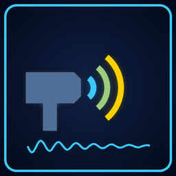

# Weapon Sounds



**The weapons' sounds remastered: modern, punchy and heavy, each one switchable.**

Version **1.0.0** · Weapons, Audio · by VibinToast · needs Jet Force Gemini: Recompiled 1.3.0 or newer

## About

The weapons' own sound effects, remastered to sound modern and heavy: rebuilt highs, a sub-bass punch under every shot, a sharper attack and a stereo room. The pistol cracks, the sniper rifle booms and rolls away in a long reverb, the machine gun is a dense automatic stream with a softer settle when you let go, missiles and rockets launch with a boom, the plasma shotgun's charge builds under you and its shot hits hard, the shocker hums deep, and changing weapons racks steel on steel. Throws and grenade bounces keep their sound with more bass; the flamethrower, explosions and the enemies' weapons keep the game's. Each weapon's sounds can be turned off in the options, during play too.

## Options

Change them in the game's Mods menu (the mod's Configure page) or on the launcher's Mods page.

| Option | What it does | Choices | Default |
|---|---|---|---|
| **Pistol** | The pistol's shot. Off: the game's own sound. | Off / On | On |
| **Sniper Rifle** | The sniper rifle's own shot: heavier, with a long reverb rolling off the walls. Off: the game's own sound. | Off / On | On |
| **Machine Gun** | The automatic stream, its last round and the settle when you let go. Off: the game's own sound. | Off / On | On |
| **Missiles & Rockets** | Homing missiles and the tri-rocket launcher. Off: the game's own sound. | Off / On | On |
| **Plasma Shotgun** | Its charge and its shot. Off: the game's own sound. | Off / On | On |
| **Shocker** | The shocker's current. Off: the game's own sound. | Off / On | On |
| **Throws & Grenades** | Throwing (grenades, mines, shuriken...) and grenades bouncing. Off: the game's own sound. | Off / On | On |
| **Shuriken** | A shuriken in flight. Off: the game's own sound. | Off / On | On |
| **Mines** | A mine arming. Off: the game's own sound. | Off / On | On |
| **Flares** | A flare being lit. Off: the game's own sound. | Off / On | On |
| **Weapon Change** | Changing weapons. Off: the game's own sound. | Off / On | On |

## Install

- **In the game's launcher:** open **Get Mods**, pick this mod and press **Install** (it keeps it up to date).
- **By hand:** download `jfg_weapon_sounds.nrm` from its release, [`jfg_weapon_sounds-v1.0.0`](https://github.com/VibinToast/JFG-Mods/releases/tag/jfg_weapon_sounds-v1.0.0), and put it in the game's `mods` folder.

## Build

From this folder, as in the [collection's README](../README.md#building-a-mod):

```sh
make SYMS=/path/to/JFGRecompSyms && make nrm SYMS=/path/to/JFGRecompSyms
```

The mod is written to `build/jfg_weapon_sounds.nrm`.

## What's here

- `src/`: the mod's C code
- `include/`: the port's mod API headers (`jfg_api.h`, `jfg_util.h`), copied from the port
- `sounds/`: the mod's sound effects (made by `make_sounds.py`)
- `mod.toml`: the manifest: name, version, tags, options
- `Makefile`: builds the mod (`make`, then `make nrm`)
- `mod.ld`: the linker script
- `thumb.png`: the picture shown in the Mods menu and on Get Mods
- `jfg_sounds.json`: which sounds the mod plays or replaces
- `make_sounds.py`: synthesizes the sounds in `sounds/`
