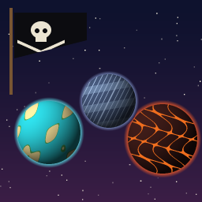

# Corsair Reach



**A galaxy of its own: three new worlds of levels, from a pirate island to a storm world and a volcanic forge.**

Version **0.1.0** · Levels, Enemies · by VibinToast · a level pack made in JFG-Studio · needs no other mod

## About

Insect corsairs have raided the worlds of Corsair Reach, and their latest prize is the Stormglass, a Tribal relic
that calls the weather. Follow it across three worlds:

- **Driftwood Cay**: a tropical island, played down through a day: a noon beach with a wrecked ship lying on it,
  the corsairs' harbour at sunset, and their torch-lit grotto at night.
- **Mirefall**: a rain world, its town drowning under a storm engine's clouds. Choose your way through the town.
- **Cinderhold**: a volcano, climbed level by level to the forge on its summit, and a last fight in waves.

Every world has its own enemies, Tribals to rescue, keys, switches and secrets, and it gets harder as you go. The
galaxy is open from the start: on the planet map press **R** (on a controller RB or D-pad right) and fly to Driftwood
Cay. Each world opens once the one before it is completed. Nothing needs the jetpack or hover; any hero can play it
at any point of a game. A few secrets want a particular hero: in Cinderhold, only Juno walks on lava unhurt.

## Levels

Twelve levels, four to a world. Each world has one optional level, reached by a side way and rejoining the main
route further on.

| World | Levels |
|---|---|
| **Driftwood Cay** | Sunwreck Beach · Gullwing Docks · Blackwater Grotto · Smugglers' Run (optional, under the docks) |
| **Mirefall** | Stiltwater Outskirts · Drowned Bellmarket (the hub) · The Undercistern · Stormspire |
| **Cinderhold** | Slag Flats · The Bellows · Caldera Crown (the finale) · Coolant Vents (optional, beside the foundry) |

Every level has a way back to the one before it, except a world's first. In Mirefall the town is a hub: the key to
its inner gate lies in the waterworks below it. Each world's last level completes it, opens the next world on the
map, and shows the world's stats as you leave. The finale's way out takes you home.

Weapons to find: the machine gun once in every world (before any switch needs shooting), and in the optional levels
and the grotto's vault, grenades, a shotgun and rockets. Each world hides one health upgrade.

## Install

- **In the game's launcher:** open **Get Mods**, pick this pack and press **Install**.
- **By hand:** download `toast_corsair_reach.nrm` from its release and put it in the game's `mods` folder.

## Build

`corsair_reach.jfgproj/` is the JFG-Studio project. Its level geometry isn't stored here: the scripts in `blender/`
build each level from nothing, using the game's own textures from your ROM (JFG-Studio's catalog), so build it once
on your machine:

1. Open the project in JFG-Studio once, so it builds its catalog of your game's textures.
2. Build each level's geometry in Blender 5.2 with the jfg64 add-on (0.6.0 or newer):
   ```sh
   blender --background --factory-startup --addons jfg64 --python blender/sunwreck.py
   blender --background --factory-startup --addons jfg64 --python blender/gullwing.py
   ```
   and so on, one script per level, named after the level's project name: `sunwreck`, `gullwing`, `blackwater`,
   `smugglers`, `stiltwater`, `bellmarket`, `undercistern`, `stormspire`, `slagflats`, `bellows`, `crown`, `vents`.
   Each writes its level's `.glb` to `blender/out/` (`sunwreck.glb`, `gullwing.glb` ...).
3. In JFG-Studio, import each into the project (File > Import geometry, or the `reimport_geometry` tool) under its
   own name (`sunwreck`, `gullwing`).
4. Build the pack in JFG-Studio, or from the command line:
   ```sh
   jfgstudio build corsair_reach.jfgproj -o toast_corsair_reach.nrm
   ```

The enemies' looks, the skies and the pack's picture are drawn by `blender/kinds.py`, `blender/sky_*.py` and
`blender/thumb.py`; they are our own images, already in the project (`kinds/`, `skies/`).
