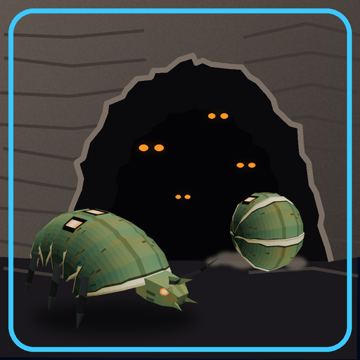

# Shellback Burrows



**Rolling Shellback squads lurk in caves and around cave mouths across the game.**

Version **0.2.0** · Enemies, Levels · by VibinToast · a level pack made in JFG-Studio · needs [jfg_shellback](../jfg_shellback) (installed with it)

## About

The Rolling Shellbacks have dug in. Squads of the armoured beetles now lurk in the game's caves and mines, and around the mouths of the caves where they come out to hunt: seven squads across five areas. Wherever the rock closes in, listen for the hiss: they curl up and come rolling down the tunnels at you, bouncing off the walls. Needs the Rolling Shellback mod, which is installed with it.

## Install

- **In the game's launcher:** open **Get Mods**, pick this pack and press **Install**: the mods it needs come with it.
- **By hand:** download `toast_shellback_levels.nrm` from its release, [`toast_shellback_levels-v0.2.0`](https://github.com/VibinToast/JFG-Mods/releases/tag/toast_shellback_levels-v0.2.0), and put it in the game's `mods` folder with the mods it needs.

## Build

`shellback_burrows.jfgproj/` is the JFG-Studio project: 5 of the game's areas, each with the squads it adds. Open it in JFG-Studio to see or change where they are, then build it there, or from the command line:

```sh
jfgstudio build shellback_burrows.jfgproj -o toast_shellback_levels.nrm
```

JFG-Studio reads the game's levels from your own ROM, so the project holds only what the pack adds.
